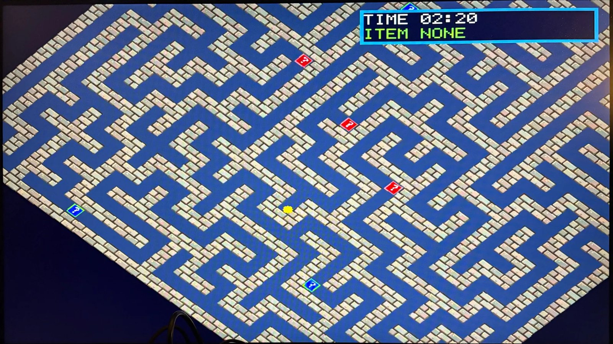

# Labyrinth Runner

A tilt-the-maze ball game in Verilog for the Digilent **Basys 3** (Artix-7 XC7A35T). The whole maze rotates on a VGA monitor, gravity always pulls the ball straight down the screen, and you steer it to the exit by turning the maze with a mouse or the board buttons.

Built for EE2026 (Digital Design) by team S2_19.



## Features

- **Rotating maze at 640×480.** Each pixel is rotated on the fly as the beam scans, so no frame buffer is needed. The angle has 4096 steps per turn, with a 90° snap mode on SW15.
- **Ball physics.** Gravity, wall collision and bounce run once per frame in Q9.8 fixed point.
- **New maze every game.** A depth-first search (recursive backtracker) with an xorshift32 random source carves the maze. Extra loops are then cut in so there is more than one route.
- **Stages.** EASY (5×5 cells), MEDIUM (10×10), HARD (15×15), EPIC (20×20) and CUSTOM (5 to 20, set on SW3–SW0). Each has its own time limit.
- **Following camera.** Large mazes scroll with the ball, using a dead zone and smooth easing.
- **Item boxes.** Blue boxes are buffs: low gravity, invincibility, a time bonus, or a wall breaker. Red boxes are debuffs: reverse, high or zero gravity, inverted controls, fog of war, or instant death. A roulette on the OLED shows which item you rolled.
- **Menus and HUD.** Stage select, settings, instructions, pause, and win/lose screens. Best times are shown in the menu, the time left on the 7-segment display, and status text on the OLED.

## Controls

| Input | Action |
|---|---|
| Mouse left / right, or btnL / btnR | Rotate the maze |
| btnU / btnD | Move through menus; btnU pauses during play |
| btnD (in play) | Make a new maze |
| btnC | Confirm, or go back to the menu. Hold for about 2 s to fully reset |
| btnL / btnR (in menu) | Open settings / instructions |
| SW15 | 90° snap rotation |
| SW14 | Fixed seed, so the same maze appears every time (for debugging) |
| SW3–SW0 | CUSTOM maze size (5 + value) |

**Hardware:** Basys 3, a VGA monitor, a USB mouse, and a Pmod OLED (96×64) on the Pmod port.

## Building

Vivado 2025.2, part `xc7a35tcpg236-1`. Run from the repo root.

Make a Vivado project (it goes in `vivado/`):

```bash
vivado -mode batch -source scripts/create_project.tcl
```

Or build a bitstream directly (it goes in `build/`):

```bash
vivado -mode batch -source scripts/build_bitstream.tcl
```

## Repository layout

| Path | Contents |
|---|---|
| `rtl/` | Design sources. The top module is `My_Top_Module.v`; shared constants are in `labyrinth_pkg.vh` |
| `constraints/` | `basys3.xdc` pin and clock constraints |
| `tb/` | Testbenches and their run scripts |
| `scripts/` | Vivado build and report scripts, plus generators for the font and sin/cos tables |
| `docs/` | Design notes and screenshots |

## Design at a glance

- **Clocking.** Everything runs on the 100 MHz board clock, with a 25 MHz pixel enable for VGA. The OLED alone runs on 6.25 MHz.
- **Resources.** About 41% of LUTs, 18% of FFs, 4 BRAMs and 6 DSPs. Timing is met at 100 MHz.

| Module | Role |
|---|---|
| `maze_gen.v` | DFS maze generator and loop/item-box placement |
| `render.v`, `vga_timing.v` | Rotated maze renderer and VGA timing |
| `ball_physics.v`, `ball_overlay.v` | Gravity, collision and bounce, and drawing the ball |
| `camera.v` | Camera that follows the ball |
| `item_ctrl.v`, `item_roulette.v` | Item rolls, effect timers and the OLED roulette |
| `game_ctrl.v`, `menu_ctrl.v`, `game_timer.v` | Game state machine, menus and time limits |

## Team

- Han Qi-Ze ([@eziqnah](https://github.com/eziqnah))
- Chua Choon Hsiang ([@ChuaJx-NUS](https://github.com/ChuaJx-NUS))
- Kim Doyeon ([@doyk0215](https://github.com/doyk0215))

## Credits

- The 5×7 font matches the SparkFun GraphicLCD_Nokia_5110 ASCII table (MIT licence).
- The PS/2 mouse (`Mouse_Control.vhd`, `Ps2Interface.vhd`), OLED driver and Basys 3 XDC come from the course and Digilent materials.
