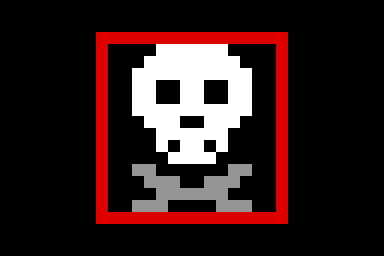

# Instant Death (ID 9)

As confirmed by CJX, this debuff returns the ball to its normal start tile and
zeros both velocities. It preserves the current run and stays in PLAY; only
an independent timeout, goal, reset or regeneration changes that flow.

The OLED result is a white skull with gray crossbones and the existing red
debuff border. The 16x16 art uses the normal centred 3x presentation on 96x64.
The original eight icons and their palettes are byte-for-byte unchanged.

## Interfaces and coordination

Based on main `654fbf2` (merged #100). The UI expansion is paused; Kim owns
Wall Breaker. CJX explicitly chose **ID 9** here, reserving **ID 8** for Kim.
No Wall Breaker behavior or pool entry is implemented by this branch.

- IDs 0..7 remain stable. `ITEM_INSTANT_DEATH=9`, `ITEM_NONE=15`.
- `ITEM_ICON_W=4`, `ITEM_VISUAL_W=5`: visual bundle is `{icon_source, icon[3:0]}`.
  The source bit is now bit 4 in every producer, held mailbox, display consumer
  and acknowledgement. Slot 8 renders black until Kim supplies its asset.
- Buff choices remain 0/1/2. Debuff choices are 3/4/5/6/7/9; rejection sampling
  caches six choices without division on the pickup path. Roulette skips 8.
- `item_ctrl.instant_death_pulse` is emitted once on the accepted immediate
  pickup or acknowledged selected-result commit. A spinning candidate, blocked
  box, paused commit or cancelled pending result emits no action.
- Instant Death never replaces/refreshes the active effect. Its duration and
  fractional phase continue normally, like the instant time bonus. No time is
  granted. Existing invincibility blocking/consumption/respawn applies.
- `ball_physics.instant_respawn` is separate from global `phys_init`. It places
  the ball at spawn, clears velocities/fractional carry and flushes the current
  gravity/collision pipeline, including suppressing stale `phys_done`.
  Only camera placement shares the new action; item/timer/maze initialization
  is untouched. Item/camera consumers mask a simultaneous stale completion.

## Priority and safe application

`instant_death_respawn` queues the accepted action. It applies one system clock
after the next VGA frame tick, during blanking, allowing `game_ctrl` to make
its existing frame-boundary decision first. WIN, LOSE, regeneration/new-maze,
menu or reset cancel pending work. A same-boundary goal or timeout wins over
respawn; deadline priority over goal remains unchanged. An asserted deadline
or goal also masks application. Pause entry masks it, PAUSED retains it, and
Resume waits for a fresh frame window. Multiple system clocks or OLED result
hold frames cannot repeat the action.

The maze bits, seed, angle, active configuration, box visibility/respawn clocks,
countdown and its partial second, completed-level count, high scores and active
timed effect are preserved. Their clocks continue normally during PLAY. The
camera snaps to the returned ball on large maps; small maps keep a fixed view.

## Validation

Vivado 2025.2 on 2026-11-05, RTL `70e10e8`: **17 distinct focused benches PASS**.
Run `source tb/run_story103.tcl`. Twelve passed before the older EPIC fixture
stopped the run; after correcting that fixture, it and the remaining four
benches passed in a targeted continuation. The runner accepts individual
bench names as Tcl arguments for targeted reruns. No test failure is ignored.

- Item tests cover immediate/deferred ID 9, exactly-once action, invincibility,
  box consumption, pause/cancellation, and unchanged active-effect phase.
- Real physics/camera checks cover all four preset sizes and every collision
  state, zero velocity, stale-writeback suppression, pause/resume and terminal
  priority. Existing gravity/collision/camera/N=15/N=20 checks pass.
- Full top uses real generated HARD boxes, completed physics and both clock
  domains. It verifies a complete 6,144-pixel skull-only OLED frame, source/ID
  separation, stopped-result acknowledgement, real pause/resume, one safe
  respawn, fixed map contents, seed/angle/config/score preservation, timer and
  effect fractional phases, box-clock continuity, and protected pickup.
- ROM checks cover 5,120 reads, nine distinct icons and reserved-black slot 8;
  OLED pixel checks cover all 61,440 pixels in ten ID slots. Independent checks
  confirm the original 2,048 pixel indices and 32 palette words are unchanged.
- Existing item pools/durations, delayed roulette, timer, time-bonus, controller
  and top timeout/reset benches pass. The integration fixture shortens the
  button debouncers and scanout visibility for simulation; no activation input
  or gameplay signal is changed in RTL.

The hardware build is running; final routed evidence will be appended before
the board handoff. No board PASS is claimed.

Captured from the actual top OLED pixel stream (shown 4x):

The EPIC play fixture previously treated slot 3 as a debuff, predating the
existing four-buff/four-debuff EPIC layout. It now uses slot 4 and permits the
new ID 9. This changes only test data; no box count or placement was changed.

The complete current-stories suite is not claimed; unrelated older OLED tests
still require their previously identified frame-scheduling fixture updates.

## Board checklist (pending)

1. Start MEDIUM, HARD, EPIC or a CUSTOM stage with red boxes; collect a red box
   until roulette stops on the skull. Confirm the same red frame as other
   debuffs, a complete stable icon, and no action while it is still spinning.
2. At the selected skull result, confirm the ball returns to the start at rest
   and the camera follows on HARD/EPIC. Ordinary movement resumes on later frames.
3. Check the maze/seed/rotation, remaining time, completed levels and active
   timed effect remain intact. No regeneration, time bonus or TIME UP occurs
   just because of this item. The box remains consumed and respawns normally.
4. With invincibility active, a red-box pickup shows the existing shield
   notification and does not respawn the ball or refresh protection.
5. Pause during roulette / after result, resume, and verify one action only.
   Check menu/reset/new maze cancels pending work and normal WIN/timeout wins.
6. Record source commit, PASS/FAIL and a note/photo on the PR for peer review.
