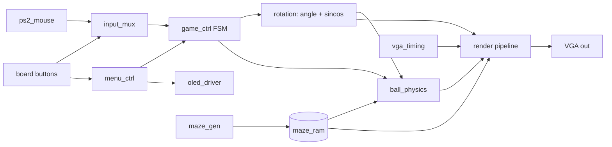
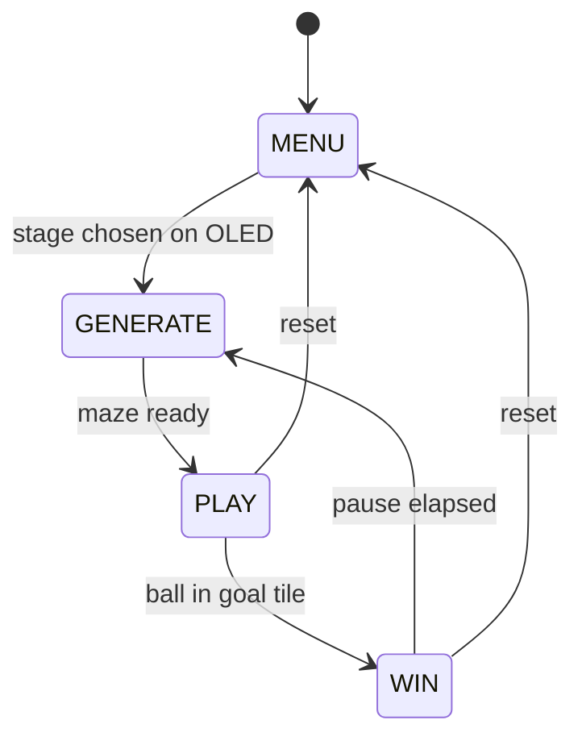

# Architecture Spine — 2D Labyrinth on FPGA

Reviewed and approved by the user on 2026-10-23; the tags below were confirmed.

## Design Paradigm

**Racing-the-beam pipeline plus a frame-synchronous controller.** The video path produces each pixel on demand from the maze tile map, the current angle and the ball position; no pixel is ever stored. A game controller FSM advances the state once per frame at vertical blanking. Everything runs in one 100 MHz clock domain, using clock enables for slower rates.

The board is the constraint (XC7A35T-1CPG236C: 20,800 LUTs, 41,600 flip-flops, 1,800 Kb block RAM in 50 tiles, 90 DSP slices, 5 clock tiles). Every decision below favours less memory and fewer LUTs.



Dependency direction: leaf I/O blocks (`ps2_mouse`, `oled_driver`, `vga_timing`) depend on nothing. `render` reads state and never writes it. Only `game_ctrl` sequences state changes. `maze_gen` writes `maze_ram` and nothing else.

## Invariants & Rules

### AD-1 — No framebuffer; pixels are computed in the beam
- **Binds:** FR-7, FR-18, NFR-3
- **Prevents:** One builder allocating a 640×480 buffer (3.69 Mb) that exceeds the whole chip's 1.8 Mb of block RAM, another building a half-size buffer that breaks rotation.
- **Rule:** No block may store a screen-sized image. Each pixel is derived from the maze tile map, the angle snapshot and the ball snapshot. A line buffer is allowed only if it is at most 640 × 12 bits.

### AD-2 — One clock domain, clock enables for everything slower
- **Binds:** all, NFR-1
- **Prevents:** Derived clocks and extra MMCM/PLL instances, which cause clock-domain-crossing bugs and timing failures.
- **Rule:** Every register is clocked by the 100 MHz board clock. The pixel rate is a 1-in-4 enable `ce_pix` (25.0 MHz; refresh ≈ 59.5 Hz, converters normally accept it). The OLED SPI clock is generated from an enable, never a divided clock net. **One documented exception (2026-10-24):** the course-supplied `Oled_Display.v` (Pmod OLEDrgb, may not be modified) needs a real 6.25 MHz clock, so `oled_clk_div` divides 100 MHz by 16 through a BUFG for that module alone, declared with `create_generated_clock`; everything else, including the text-to-pixel logic, stays on the 100 MHz clock, and the crossing is a timed synchronous one. Only the PS/2 lines and the buttons are asynchronous, and each passes through a two-flip-flop synchronizer on entry. The 4 clocks per pixel are a budget available to the render pipeline.

### AD-3 — The maze frame is the physics frame; the angle is the only coupling
- **Binds:** FR-7, FR-8, FR-8b, FR-14
- **Prevents:** Physics done in screen space against rotated walls, or two different notions of "down".
- **Rule:** Ball position and velocity live in maze coordinates. Gravity in maze coordinates is `g·(sinθ, cosθ)` (screen-down expressed in the maze frame; this is the direction implied by `render.v`'s screen-to-maze mapping `maze_x = 168 + dx·cos + dy·sin`, `maze_y = 168 − dx·sin + dy·cos`, corrected from `(−sinθ, cosθ)` in Story 3.1), computed from the same `sincos` output the renderer uses. The renderer maps each screen pixel to maze coordinates by rotating about the screen centre. The ball is drawn as a circle in screen space (its screen position is the rotated maze position), so it always looks round. No centrifugal, Coriolis or moving-wall effects are modelled (FR-8b).

### AD-4 — Fixed-point formats live in one package file
- **Binds:** FR-10, FR-11, FR-13, NFR-5
- **Prevents:** Modules disagreeing on scaling and silently overflowing.
- **Rule:** All widths and scales are `localparam`/`define`s in `labyrinth_pkg.vh`, and no module hard-codes its own.
  - Angle: 12-bit unsigned, 4096 = 360°.
  - Trig: signed Q1.14, from a 2048-entry half-wave table (about 30 Kb, one block RAM tile) with symmetry; one synchronous read per output, one clock of latency.
  - Positions: signed Q9.8 in maze pixels, relative to the maze centre. Velocities: signed Q4.8 in px/frame.
  - Tile: 16 px. Tile map: 21×21 bits (10×10 cells plus walls), 1 = wall.
  - Ball radius: 5 px. Speed cap: 7 px/frame per axis (Q4.8 cannot represent 8), so that a 16 px wall can never be skipped.
  - Restitution is shift-and-add only (for example 0.5 = `>>1`, 0.75 = `v − (v>>2)`); there is no runtime division and multipliers are limited to the per-frame and per-scanline setup (AD-7) within the DSP budget in AD-8.

### AD-5 — Single writer per shared state
- **Binds:** FR-1, FR-10, FR-15, FR-22, FR-26
- **Prevents:** Two modules writing the same register or RAM and producing races.
- **Rule:**

| State | Sole writer | Readers |
| --- | --- | --- |
| `maze_ram` (tile map) | `maze_gen` | `ball_physics`, `render` |
| `angle`, `ball_pos`, `ball_vel` | `game_ctrl` datapath (on `frame_tick`) | `render` |
| `game_cfg` (stage, restitution, speed) | `menu_ctrl` | `game_ctrl` (latched at game start) |
| `status_text` (OLED line buffer) | `menu_ctrl` | `oled_driver` |

`maze_ram` is a dual-port memory (one read for physics, one for the render path), which fits distributed RAM or one block RAM.

### AD-6 — State changes only on `frame_tick`; the renderer reads a snapshot
- **Binds:** FR-5, FR-6, FR-9, FR-18, NFR-2
- **Prevents:** Tearing, and the picture changing mid-frame.
- **Rule:** `vga_timing` emits one `frame_tick` at the start of vertical blanking. The angle update, physics step and win check all happen in the blanking interval, which is long enough for a few hundred cycles of sequential work. The renderer latches `angle_q` and `ball_q` at frame start and uses only those until the next frame. Physics may take multiple clock cycles but must finish before the first visible line.

### AD-7 — Rendering is an incremental affine walk with a fixed latency
- **Binds:** FR-6, FR-7, FR-18, NFR-1, NFR-3
- **Prevents:** Per-pixel multipliers, which would cost DSPs and fail timing.
- **Rule:** At the start of each scanline the pipeline computes the maze coordinates of pixel 0 with a small number of multiplies. Across the line it advances by adding the (cos, sin) step per pixel, with no multiplier in the per-pixel path. The maze coordinate is converted to a tile index with shifts, then one read of `maze_ram` gives wall or floor. Sampling is nearest-neighbour (jagged edges accepted). Pixels outside the tile map are background. The pipeline has a fixed latency (a constant parameter) and the sync/blank signals are delayed by exactly that amount. A 10×10-cell maze at 16 px (336 px, half-diagonal 237 px) always fits within the 480-line screen at any angle.

### AD-8 — Resource budget is a hard gate
- **Binds:** NFR-3, all modules
- **Prevents:** Late-discovered overflow of the board.
- **Rule:** Post-implementation usage on the XC7A35T must stay at or below these limits. Exceeding one blocks merging that module.

| Resource | Available | Budget |
| --- | --- | --- |
| LUTs | 20,800 | ≤ 50% (10,400) |
| Flip-flops | 41,600 | ≤ 30% |
| Block RAM (36 Kb) | 50 | ≤ 6 |
| DSP48 | 90 | ≤ 8 (no per-pixel DSP) |
| Clocking | 5 tiles | 0 used (board clock only) |

Memory plan: maze tile map 441 bits; DFS stack about 100×7 bits; trig table about 30 Kb in one block RAM tile (kept out of LUTs so the angle-to-trig path meets 100 MHz); OLED font about 6 Kb and text buffer 64 bytes. Apart from the trig tile, the total is far below one block RAM tile. No Vivado IP cores are used, so everything stays in plain Verilog.

### AD-9 — Input abstraction: a rotation command, not raw devices
- **Binds:** FR-5, FR-6, FR-19
- **Prevents:** Game logic depending on PS/2 details, or a missing mouse blocking the demo.
- **Rule:** `input_mux` outputs a single `rot_cmd` (−1, 0, +1). Left held = −1 (counter-clockwise), right held = +1 (clockwise), both or neither = 0. Either source rotates the maze: left = mouse left OR BTNL, right = mouse right OR BTNR (amended 2026-10-26: a packet-timeout "connected" switch dropped a mouse button held still, because a PS/2 mouse sends packets only when it moves or a button changes). `ps2_mouse` runs stream mode (sends enable `0xF4` after reset), decodes 3-byte packets, and exposes only the button bits and a `connected` flag. The Basys 3 USB-HID host can fail with some mice, so the fallback is part of the design.

### AD-10 — OLED is a text-only peripheral behind a buffer
- **Binds:** FR-20..FR-26
- **Prevents:** Menu logic mixed with SPI timing; pixel-level graphics that the budget doesn't need.
- **Rule:** `menu_ctrl` writes a 4-row × 16-column character buffer (`status_text`) and owns `game_cfg`. The OLED is the Pmod OLEDrgb (96×64, SSD1331). The course-supplied `Oled_Display.v` does the initialization, reset and SPI (SCLK 6.25 MHz, D/C and reset in its own sequence; the manual's orderly power-down is waived), and `oled_text_pixel` turns the buffer into its pixel stream through a 5×7 font ROM (6 px per character, 16 px per text row). The menu is driven by BTNU/BTND/BTNC. The OLED never reads game state directly; `game_ctrl` hands the stage number and timer to `menu_ctrl`.

### AD-11 — Collision by per-axis move and tile test
- **Binds:** FR-11, FR-12, FR-13
- **Prevents:** Tunnelling and the ball getting stuck inside walls.
- **Rule:** On each step, move along x, test the ball's bounding box against the tile map, and if blocked, clamp to the tile edge and apply the restitution to that axis's velocity; then repeat for y. Tangential velocity is untouched (no friction). The speed cap in AD-4 guarantees correctness. Goal detection is "ball centre inside the goal tile".

### AD-12 — Maze generation is a stage-gated iterative DFS
- **Binds:** FR-1, FR-2, FR-3, NFR-5
- **Prevents:** A generator that can leave unreachable cells, or that runs while the game reads the map.
- **Rule:** `maze_gen` is a recursive-backtracker implemented as an iterative FSM with an explicit stack (dimension N set by the stage). It runs only in the GENERATE state, and it ends with start and goal cells set. The seed is a free-running counter latched on the first user input, or a fixed seed when a debug switch is set. A 32-bit LFSR provides the randomness. The perfect-maze property guarantees solvability.

### AD-13 — Every module ships with a self-checking testbench
- **Binds:** NFR-4, NFR-5, Success criteria
- **Prevents:** Integration surprises in the last week, and unprovable claims in the report.
- **Rule:** Each module has a testbench that asserts and prints PASS/FAIL, runnable in batch from Vivado. Required checks: `maze_gen` (BFS reach from start to goal on many seeds), `ball_physics` (no tunnelling, bounce ratio equals restitution), `ps2_mouse` (a recorded packet stream), `vga_timing` (line and frame counts), `render` (compare a few pixels against a software model for known angles).

## Consistency Conventions

| Concern | Convention |
| --- | --- |
| Naming | Plain Verilog-2005. Module = file name, snake_case. Signals: `_q` registered snapshot, `_n` next value, `_en`/`ce_` enables, active-high unless suffixed `_n_i`. |
| Interfaces | Valid/strobe single-cycle pulses; no tri-states except the PS/2 open-drain pins at the top level. |
| Data & formats | Defined only in `labyrinth_pkg.vh` (AD-4). Signed values declared `signed` with explicit widths. |
| State & cross-cutting | Synchronous reset from one debounced reset signal; no latches; no combinational loops; no initial blocks relied on for synthesis except ROM contents. |
| Constraints | One XDC file for the whole board, derived from Digilent's master XDC; clock 100 MHz declared once. |

## Stack

| Name | Version |
| --- | --- |
| FPGA part | XC7A35T-1CPG236C (Basys 3, Artix-7) |
| HDL | Verilog (IEEE 1364-2005) |
| Toolchain | Vivado 2025.2 |
| Display | VGA 640×480, 12-bit colour, then an external VGA-to-HDMI converter |
| Secondary display | Digilent Pmod OLEDrgb, 96×64, SSD1331, SPI |
| Input | USB-HID mouse via the board's PS/2 emulation |

## Structural Seed

```text
rtl/
  labyrinth_pkg.vh     # all widths, scales, constants (AD-4)
  top.v                # pin-level wiring, synchronizers, clock enables
  vga_timing.v         # counters, syncs, frame_tick
  render.v             # affine walk + maze lookup + ball + colour
  sincos_rom.v         # half-wave table in one block RAM
  game_ctrl.v          # state FSM: MENU, GENERATE, PLAY, WIN
  ball_physics.v       # gravity, move, collide, goal test
  maze_gen.v           # iterative DFS, LFSR
  maze_ram.v           # 21x21 dual-read tile map
  ps2_mouse.v          # PS/2 receiver, packet decoder
  input_mux.v          # rot_cmd from mouse or buttons
  menu_ctrl.v          # stages, settings, status_text
  Oled_Display.v      # course-supplied SSD1331 driver (unmodified)
  oled_clk_div.v       # 6.25 MHz clock for Oled_Display (AD-2 exception)
  oled_text_pixel.v    # status_text -> RGB565 pixel stream
  font_rom.v           # 5x7 font
tb/                    # one testbench per module
constraints/basys3.xdc
```



## Capability → Architecture Map

| Capability / Area | Lives in | Governed by |
| --- | --- | --- |
| Random solvable maze (FR-1..FR-4) | `maze_gen`, `maze_ram` | AD-5, AD-12 |
| Hold-to-rotate and smooth rendering (FR-5..FR-8b) | `input_mux`, `game_ctrl`, `sincos_rom`, `render` | AD-3, AD-7, AD-9 |
| Ball physics (FR-9..FR-14) | `ball_physics` | AD-3, AD-4, AD-11 |
| Game flow (FR-15..FR-17) | `game_ctrl` | AD-5, AD-6 |
| Maze on monitor (FR-18, FR-20) | `vga_timing`, `render` | AD-1, AD-2, AD-6, AD-7 |
| PS/2 mouse (FR-19) | `ps2_mouse` | AD-9 |
| OLED menu, stages, settings (FR-21..FR-26) | `menu_ctrl`, `oled_driver`, `font_rom` | AD-5, AD-10 |
| Timing, resources, testbenches (NFR-1..NFR-5) | whole design | AD-2, AD-8, AD-13 |

## Deferred

- Pin assignments and exact button roles beyond AD-9/AD-10: set in the XDC when wiring up.
- Colours, ball and goal graphics, win animation: render details, decided when drawing.
- Exact angular speed, restitution defaults and per-stage settings: tuned on hardware.
- Smoothing the jagged rotated edges (supersampling): only if resources and time allow.
- Debounce timing and PS/2 timeout values: set in the module.
